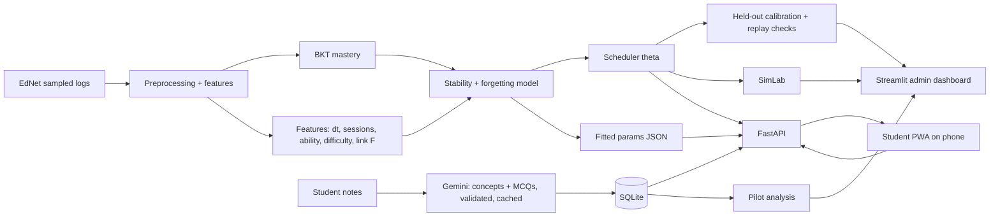

# REMEM — Final Master Specification

**Personalized Knowledge Retention, Forgetting Prediction and Adaptive Review Scheduling**
Final-year major project · Owner: Aryan Joshi (builder) · Presenters: Aryan & Bhameksh
**Version 3.0 FINAL — 8 November 2026.** This file replaces `sources/REMEM_Master_Specification.md` (v1.0/v2.0), which is kept only as history. It is the single source of truth: if code, report or slides disagree with this file, fix the disagreement here first, then in the code.

---

## How to read this document

| If you need… | Go to |
|---|---|
| What REMEM is and what "done" means | §1–§3 |
| Exact requirements | §4 |
| The research argument and novelty limits | §5–§6 |
| Every formula and algorithm | §7–§11 |
| Data and leakage rules | §12–§13 |
| How results are produced and what may be claimed | §14–§17 |
| How the software is built | §19–§21 |
| Repo gaps, the 4-week plan, risks, tests, ethics | §22–§26 |
| Report, paper, viva, demo | §27–§30 |
| What the audit found and fixed | Appendix A |
| Literature, decisions, open items, notation | Appendices B–E |

---

# PART I — PROJECT DEFINITION

## 1. Overview

### 1.1 One-paragraph description
REMEM is a personalised revision-scheduling system. A student gives it study material (pasted notes). It turns the notes into concepts and quiz questions, tracks how well the student knows each concept (Bayesian Knowledge Tracing), models how that knowledge fades with time (a power-law forgetting curve whose speed is personalised per student and concept), and tells the student **what to revise, when, and why**. The recommendation comes from an explicit rule — "review when predicted recall drops below a target θ" — whose behaviour is evaluated honestly against SM-2 and fixed-interval scheduling using real data, simulation with known ground truth, and a small live pilot.

### 1.2 The problem and the gap
1. **Knowledge-tracing systems** (BKT, DKT, LPKT, PFTKT, CPF) estimate whether a student knows a concept and predict the next answer. Classical BKT assumes a mastered skill is never forgotten. Deep models hide forgetting inside a recurrent state. None of them outputs or evaluates a review schedule.
2. **Spaced-repetition schedulers** (SM-2, FSRS) output review times and model forgetting, but per flashcard: no concept-level knowledge state and no sharing of evidence between related items.
3. **Gap.** An interpretable, concept-aware, personalised retention model wired to an explicit scheduling policy and evaluated *as a scheduler* — at a complexity a student team can build and defend.

### 1.3 Contribution (scoped honestly)
- **Applied/systems contribution:** one working pipeline — BKT mastery → feature-driven personalised stability → power-law retrievability → threshold scheduler → grounded explanation — with a working phone app on top.
- **Evaluation contribution:** scheduler evaluation from three independent angles (held-out calibration on real logs, closed-loop simulation with known truth, a small randomised live pilot), each with its limits stated.
- **Not claimed:** a new prediction algorithm; better AUC than CPF/LPKT; proof that REMEM improves learning outcomes; prerequisite discovery.

### 1.4 Users
- **Student (end user):** reviews their own notes on a phone.
- **Owner/admin (Aryan):** creates pilot accounts, monitors the pilot, runs experiments, presents results on the dashboard.
- **Examiners:** see the live demo, the dashboard and the report.

### 1.5 Constraints (fixed)
| Constraint | Value |
|---|---|
| People | One builder. Bhameksh presents, recruits and reminds pilot users, runs the manual test checklist |
| Time | About 4 weeks to the final viva (date to be confirmed; plan assumes about 8 Dec 2026) |
| Hardware | Windows laptop/PC, no GPU. College GPU is optional and not needed |
| Budget | Free tiers only |
| Python | 3.13 (current environment); no dependency that blocks it |
| Demo | Runs on the owner's PC; the student app on a phone |
| Understanding | Everything must be explainable by the owner at the viva; each module has a one-page viva note |

### 1.6 Non-goals
Prerequisite graphs or GNNs; deep knowledge tracing; native mobile builds; email/OAuth accounts; payments; multi-language UI; proving learning gains; reproducing LPKT/CPF.

---

## 2. Success criteria

REMEM is **done** when all of these are true (each is checkable):

| # | Criterion | Check |
|---|---|---|
| S1 | A phone user logs in, pastes notes, gets a quiz, answers it, sees a due list, a retention curve and an explanation | Scripted manual test on a real phone, from a clean clone |
| S2 | The scheduler runs end to end on EdNet held-out data and on live pilot data with the same code | Same `models/` and `scheduler/` imported by offline and online paths |
| S3 | All baselines run on the same split with the same metrics | `experiments/results/` CSVs |
| S4 | Experiments 1–4, 6, 7, 9, 10, 11 (§15) have logged runs | Run log table |
| S5 | A pilot with 8–10 accounts ran about 14 days with logged data and a delayed test | Pilot export, analysis notebook |
| S6 | Every number in the report and paper traces to a logged run | Evidence map (§29.3) |
| S7 | Unit, leakage, API, auth and persistence tests pass | `pytest` green |
| S8 | A fresh clone runs the demo on a second machine without large downloads | Clean-clone test (§21.5) |
| S9 | Report, paper draft, viva sheet and demo script exist and have been rehearsed | Checklist (§27–§30) |

---

## 3. Scope tiers

**Must have (the project fails without these):** EdNet pipeline and chronological split; in-house BKT; forgetting + stability model (global level); scheduler; SM-2, fixed-interval, BKT-no-forgetting, majority and student-accuracy baselines; Experiments 1–4, 6; FastAPI + SQLite; PWA core loop (login, notes→quiz, due list, practice, concepts, retention curve, explanation); owner-issued accounts; pilot launched and logged; admin dashboard; report; tests; clean-clone demo.

**Should have:** hierarchical offsets (concept → student → pair); concept-linked review (Experiment 9); simulated-student lab (Experiment 10); ablations (Experiment 7); delayed pilot test and analysis (Experiment 11); three-seed statistics; question-difficulty offset; paper draft.

**Stretch:** web-push reminders; ASSISTments cross-dataset (Experiment 8); IRT 1PL difficulty; PDF upload; short-answer questions; software copyright filing.

**Dropped:** DKT/LSTM, React Native/Expo, prerequisite graph/GNN, native builds.

**Cut order when behind schedule** (first cut first): ASSISTments → IRT/question offset → PDF/short-answer → three-seed statistics → concept-linked review → student/pair offsets → SimLab detail → dashboard polish. **Never cut:** pipeline, scheduler, baselines, evaluation, PWA core loop, pilot, tests, report.

---

# PART II — REQUIREMENTS

## 4. Requirements

### 4.1 Functional — student app (PWA)
| ID | Requirement | Priority |
|---|---|---|
| FR-S1 | Log in with owner-issued username and password; no self-registration | Must |
| FR-S2 | On first login show the consent text; block data entry until accepted | Must |
| FR-S3 | Paste notes; see generation progress; see the resulting concepts | Must |
| FR-S4 | Each concept gets at least 5 four-option MCQ variants (4 for reviews, 1 reserved for the delayed test); the first quiz happens right after creation | Must |
| FR-S5 | Home shows concepts due now, ranked by ascending predicted recall, one reason line each | Must |
| FR-S6 | Practice flow: show one question, record answer and response time, show correctness, show the new next-review date | Must |
| FR-S7 | Concept list: mastery %, stability (days), last reviewed, next due | Must |
| FR-S8 | Retention-curve screen: predicted recall R(t) drawn forward in time with the next-review marker | Must |
| FR-S9 | Explanation text built only from computed quantities (§11.2) | Must |
| FR-S10 | Flag a bad question; flagged questions are excluded | Should |
| FR-S11 | Offline: cached due list; answers queued and replayed exactly once | Should |
| FR-S12 | Change password; log out | Should |
| FR-S13 | θ what-if slider on the retention screen, **demo/admin account only** (pilot users must not be able to change the scheduling target) | Should |
| FR-S14 | Installable to the home screen; usable at 360 px width | Should |

### 4.2 Functional — admin and research
| ID | Requirement | Priority |
|---|---|---|
| FR-A1 | Script to create/disable/reset accounts (max 10 pilot accounts); passwords stored only as salted hashes | Must |
| FR-A2 | Streamlit dashboard: experiment tables and figures, baselines, ablations, SimLab results | Must |
| FR-A3 | Pilot monitor: active users, reviews per day, adherence, LLM error/flag rates | Must |
| FR-A4 | Export pilot data pseudonymously; delete a user's data on request | Must |
| FR-A5 | Nightly database backup copy | Should |

### 4.3 Functional — ML and evaluation
| ID | Requirement |
|---|---|
| FR-M1 | Preprocessing builds the feature table of §12 with strictly causal features and a global chronological split |
| FR-M2 | In-house BKT fitted per concept with pooled fallback |
| FR-M3 | Stability + forgetting model fitted by regularised maximum likelihood (§9) |
| FR-M4 | Scheduler computes recommended review time, due status and ranking (§10) |
| FR-M5 | SM-2, fixed-interval, BKT-no-forgetting, global-exponential, majority, student-accuracy baselines (§14) |
| FR-M6 | Evaluator computes AUC, log loss, Brier, ECE, reliability bins and scheduling metrics |
| FR-M7 | Every experiment run writes config, seed, git commit, timing and metrics to a CSV row (§15.3) |
| FR-M8 | The same model code is used offline and inside the API |

### 4.4 Non-functional
| ID | Requirement |
|---|---|
| NFR-1 Correctness | Probabilities stay in [0,1]; stability > 0; recommended times respect bounds; `/respond` is idempotent |
| NFR-2 Performance | `GET /due` under 1 s for 200 concepts on the owner's PC; quiz generation is asynchronous with a visible status |
| NFR-3 Reliability | SQLite in WAL mode; nightly backup; app works from cached/fallback content if the LLM is unavailable |
| NFR-4 Security | Hashed passwords, hashed session tokens with expiry, per-user data isolation, login rate limiting, HTTPS whenever anyone outside the LAN connects, no secrets in the repo or logs |
| NFR-5 Privacy | Pseudonymous usernames; no names/emails stored; consent; deletion on request; notes never exported into the report; pilot raw data not committed to GitHub |
| NFR-6 Reproducibility | Fixed seeds, config files, logged runs; same seed + same config → identical metrics |
| NFR-7 Portability | Windows 11 + PowerShell commands; hand-curated `requirements.txt`; three run modes (§21.5) |
| NFR-8 Explainability | Recommendations cite only computed quantities; no LLM-written justifications |
| NFR-9 Maintainability | Typed Pydantic schemas, small modules, unit tests, a one-page viva note per module |

---

# PART III — RESEARCH DESIGN

## 5. Research questions and hypotheses

**Primary RQ.** Can a lightweight, interpretable, concept-aware retention model turn into a review schedule that reaches a target retention with fewer reviews than a fixed-interval or SM-2 schedule?

| RQ | Question | Evidence |
|---|---|---|
| RQ1 | Does elapsed time carry usable forgetting signal in the data? | Exp 1, 3 |
| RQ2 | Does a feature-driven stability term calibrate recall across time-gap bins better than one global decay rate? | Exp 3 (H1) |
| RQ3 | Does hierarchical personalisation (concept, student, pair offsets with shrinkage) help, especially for sparse histories? | Exp 4 (H2) |
| RQ4 | Does threshold scheduling driven by the model need fewer reviews than SM-2/fixed at matched retention? | Exp 10 (primary, known truth), Exp 11 (real, exploratory), Exp 6 (descriptive) |
| RQ5 | Does a recent failure on a similar concept carry signal about this concept? | Exp 9 (H4) |

**Hypotheses.**
- **H1** Recall decays with elapsed time in a way better captured by a stability term conditioned on repetition and ability than by one global rate (Loftus 1985; Radvansky et al.).
- **H2** Hierarchical shrinkage improves calibration for sparse student–concept pairs relative to unshrunk pair fitting.
- **H3** A model-driven threshold scheduler needs fewer reviews at matched retention than SM-2.
- **H4** A recent failure on a similar concept predicts lower recall on this one beyond mastery, repetition, ability and difficulty.

Every hypothesis has a stated failure outcome (§15); negative results are reported, not hidden.

**Prediction target.** Next-interaction correctness, conditioned on elapsed time since the previous interaction with that concept. Unit: (student, concept, time).

---

## 6. Related work, novelty and architecture choice

### 6.1 Closest prior work
CPF (Wang et al., arXiv:2404.12127, 2024) personalises forgetting inside an LPKT backbone using cognitive ability and a precursor–successor concept matrix, reports +2.59% AUC over LPKT on EdNet-KT1, and **does not schedule reviews**. LPKT (Shen et al., KDD 2021) and PFTKT (Tian & Wang, 2023) are also prediction-only. SM-2 and FSRS schedule but have no concept-level state. Full matrix: Appendix B.

| Aspect | CPF | SM-2 | FSRS | LPKT/PFTKT | REMEM |
|---|---|---|---|---|---|
| Predicts next-answer correctness | ✓ | ✗ | ✗ | ✓ | ✓ |
| Explicit forgetting | ✓ | heuristic | ✓ (learned) | ✓ | ✓ (feature-driven stability) |
| Personalised per student | ✓ | per-card ease | ✓ | partial | ✓ (ability + offsets) |
| Concept-level knowledge state | ✓ | ✗ | ✗ | ✓ | ✓ |
| Outputs a review schedule | ✗ | ✓ | ✓ | ✗ | ✓ |
| Evaluated as a scheduler | ✗ | n/a | partly | ✗ | ✓ (sim + pilot + calibration checks) |
| Needs curated concept hierarchy | ✓ | ✗ | ✗ | varies | ✗ (data-derived similarity) |
| Buildable by a student in weeks | ✗ | ✓ | ✗ | ✗ | ✓ |
| Interpretable forgetting term | partial | ✓ | partial | low | ✓ (named features, one curve) |

**Honest position:** REMEM is not a competitor to CPF on prediction. Its defensible position is the scheduling-plus-evaluation layer, delivered at a complexity budget CPF does not target. The report must say so plainly.

### 6.2 What is established, adapted, contributed
| Category | Content |
|---|---|
| Established | BKT as an HMM; exponential and power-law forgetting; SM-2; the idea that forgetting should be personalised |
| Reimplemented | BKT (in-house), SM-2, fixed interval, global-exponential decay |
| Adapted | FSRS's Difficulty–Stability–Retrievability idea (per card → per student × concept; the "stability = time to 90% recall" convention); PFTKT's time-gap feature (as a regression feature); CPF's personalised ability (as an auditable EWMA score) |
| Engineering contribution | The integrated pipeline, the phone app, the notes→quiz front end |
| Applied research contribution | The three-angle scheduler evaluation; the BKT×forgetting likelihood link (§8.3) |
| Scoped novelty | Interpretable hierarchical stability + evaluated scheduler, integrated. Not a new prediction algorithm |

### 6.3 Architecture choice (alternatives considered)
| Option | Verdict |
|---|---|
| A. BKT + forgetting layer | **Chosen core** (interpretable, CPU-only, derivable at the viva) |
| B. DKT/LSTM + forgetting | Rejected: opaque, GPU-hungry, adds nothing to the scheduling claim; cited only |
| C. Neural retention regressor | Rejected as primary: loses "stability" semantics, harder to turn into a scheduling rule |
| D. KT + memory model + scheduler, no hierarchy | Subsumed: hierarchy added as optional offsets |
| E. Transformer/GNN KT, prerequisite graph | Rejected: scope and tuning cost; needs curated metadata |
| **Selected** | **BKT + hierarchical stability + power-law + threshold scheduler** |

Forgetting-curve choice: power-law `R(t) = (1 + k·t/S)^(−β)` over exponential because meta-analyses (Rubin & Wenzel; Radvansky et al.) favour heavier tails and FSRS replaced an exponential with a power-law after fitting real logs. Hazard and logistic forms were rejected as extra machinery with no scheduling benefit. Exp 3 tests the choice; if it fails, the fallback is exponential (a reportable negative result).

### 6.4 Locked decisions
Architecture E; power-law curve; student×concept personalisation with shrinkage; global chronological split; next-answer correctness as the only training label; no prerequisite graph; scoped novelty and no causal learning claim; EdNet-KT1 as primary data; LPKT/CPF cited not reproduced; PWA student app; in-house BKT; DKT dropped; Gemini only for notes→questions; owner-issued accounts capped at 10.

---

# PART IV — MODEL SPECIFICATION

## 7. Notation

| Symbol | Meaning |
|---|---|
| s, c, i | student, concept, interaction index |
| t_i, y_i, rt_i | timestamp, correctness (0/1), response time of interaction i |
| Δt | days since the student's previous interaction with that concept |
| n_{s,c} | number of prior **sessions** with the concept (a session = a run of interactions with that concept with gaps < 30 min) |
| A_s | student ability (EWMA of past correctness) |
| D_c | concept difficulty = 1 − training-split correctness rate |
| r_{s,c} | clipped response-time z-score of the student's previous interaction with the concept |
| F_{s,c} | concept-link failure feature (§9.5) |
| m_{s,c} | BKT posterior mastery P(L) after the latest interaction |
| g_c, sl_c | BKT guess and slip for concept c |
| S_{s,c} | memory stability in days: the elapsed time at which predicted recall is 90% |
| R(Δt) | retrievability = predicted probability the knowledge is still retrievable after Δt |
| β | decay exponent (global); k = 0.9^(−1/β) − 1 |
| θ | review-trigger threshold (default 0.85) |
| w_0…w_6 | stability regression coefficients (to avoid clashing with β) |
| u_c, u_s, u_{sc} | concept, student, pair offsets on log S |

## 8. Knowledge tracing and the forgetting link

### 8.1 BKT (in-house)
Two-state HMM per concept; parameters P(L0), P(T), P(G), P(S). After observing y with prior mastery p:

```
posterior (correct)   = p·(1−S) / ( p·(1−S) + (1−p)·G )
posterior (incorrect) = p·S     / ( p·S     + (1−p)·(1−G) )
mastery_after          = posterior + (1 − posterior)·T
```
Implementation: ~40 lines of NumPy (forward filtering). **Fitting:** maximise the sequence log-likelihood with bounded multi-start optimisation (SciPy L-BFGS-B) on the training split. Bounds: G ∈ [0.02, 0.35], S ∈ [0.02, 0.30], T ∈ [0.001, 0.5], L0 ∈ [0.01, 0.9] (guess bound reflects 3–4-option MCQs and prevents the known degeneracy). Concepts with fewer than 200 training interactions use pooled parameters. pyBKT is an optional cross-check only.

BKT keeps forgetting at zero by construction; REMEM does not modify its transition matrix. Forgetting is layered on top at prediction time.

### 8.2 Concept mapping
EdNet questions carry several tags. **Each question maps to one primary concept: its rarest tag** (by training-question frequency; ties → smallest id). One interaction therefore scores once in every metric. Week 1 inspects whether tags are meaningful; the fallback is (part, rarest tag). For notes-based concepts the mapping is concept→questions as generated.

### 8.3 The BKT × forgetting link (this closes the "unobserved S" problem)
Stability S is latent — it is never observed. It is learned by making it part of a likelihood over observed correctness:

```
m_eff  = m · R(Δt; S, β)                    # mastery that survives the elapsed time
p̂      = (1 − sl)·m_eff + g·(1 − m_eff)      # probability the next answer is correct
loss   = − Σ [ y·log p̂ + (1−y)·log(1−p̂) ] + λ·‖w‖² + shrinkage penalties
```
where m is the BKT mastery after the previous interaction and S comes from §9. This is "logistic regression with a forgetting curve inside it". It is exactly the statement "forgetting wraps BKT's mastery" and it is what the scheduler later inverts.

## 9. Memory stability

### 9.1 Retrievability
```
R(Δt) = (1 + k·Δt/S)^(−β),   k = 0.9^(−1/β) − 1   ⇒   R(S) = 0.9
```
Tying k to β removes the non-identifiability of (k, S) and gives S a plain meaning: *the number of days until predicted recall falls to 90%*. β is global, fitted once. Time unit: days.

### 9.2 Base stability (global level)
```
log S_{s,c} = w0 + w1·m + w2·log(1+n) + w3·A_s − w4·D_c − w5·F_{s,c} + w6·r_{s,c}
```
All features are computed only from interactions before the one being predicted. w and β are learned by the likelihood in §8.3 (L-BFGS-B, ridge penalty λ chosen on the validation split). Coefficient signs are **not asserted**; they are reported as fitted. Stability is clipped to [0.05, 3650] days for numerical safety.

### 9.3 Student ability and response time
`A_s` = EWMA of correctness with decay γ = 0.9 (starting value: global mean until the student has 5 interactions); updated only after an interaction is processed. `r_{s,c}` = (rt − median_q)/IQR_q for the previous interaction with that concept, clipped to [−3, 3], with median/IQR from the training split. Ability is a proxy, not a psychometric measure.

### 9.4 Hierarchical personalisation (offsets with shrinkage)
Personalisation beyond the features uses additive offsets on log S, each pulled toward zero by a Gaussian prior (a ridge penalty). More data at a level → the data outweighs the penalty; little data → the offset stays near zero and S falls back to the broader level.

```
log S_{s,c}  ←  base + u_c + u_s + u_{sc}
u_c  ~ N(0, τ_c²)   u_s ~ N(0, τ_s²)   u_{sc} ~ N(0, τ_p²)
```
Fitting is **backfitting**, one pass: (1) fit global w, β; (2) estimate each u_c holding the rest fixed (a one-dimensional penalised Newton step per concept, vectorised); (3) then each u_s; (4) then each u_{sc}. τ levels are chosen on the validation split. This is the empirical-Bayes shrinkage idea in a form that is implementable and explainable ("a student with few answers on this concept stays close to the concept average"). Online (in the app), the pair offset is updated by one penalised Newton step per response. **Cold start** (§9.7) needs no special code: a missing level has offset 0.

### 9.5 Concept-linked failure feature (Experiment 9)
Similarity w_{cc'} ∈ [0,1] between concepts:
- **EdNet:** normalised co-error lift from the training split (students who fail c also fail c' more than chance), keeping the top-k neighbours above a threshold.
- **Notes concepts:** cosine similarity of `all-MiniLM-L6-v2` embeddings of the concept names, same top-k rule.

`F_{s,c}(t) = Σ_{c'} w_{cc'} · 1[fail on c' at t_{c'} within window] · exp(−(t − t_{c'})/τ_F)`, from strictly earlier interactions. The coefficient w5 is **learned, not asserted**; if indistinguishable from zero the feature is dropped from the product and reported as a negative result. This differs from CPF: no curated precursor–successor matrix, no learned causal propagation, one interpretable scalar feature judged by ablation. Explanations may mention "you recently missed *a related concept*" only when F contributed, never "prerequisite".

### 9.6 Parameter table
| Parameter | Type | Scope | Initial / range | How set |
|---|---|---|---|---|
| P(L0), P(T), P(G), P(S) | learned | per concept (pooled fallback) | bounds in §8.1 | bounded MLE on training split |
| w0…w6 | learned | global | 0 | regularised MLE (§8.3) |
| β | learned | global | start 0.3 | MLE; grid check on validation |
| λ (ridge) | hyperparameter | global | grid | validation log loss |
| τ_c, τ_s, τ_p, τ_F | hyperparameter | per level | grid | validation log loss |
| γ (ability decay) | hyperparameter | global | 0.9 | validation |
| θ | policy parameter | global | 0.85; sweep {0.75…0.95} | Exp 6/10 sweep |
| t_min, t_max | safety rails | global | 1 day, 180 days (configurable; pilot may use a shorter t_min) | not learned |
| Neighbour top-k and threshold | hyperparameter | global | grid | validation |

No value is asserted as truth before fitting; "initial" values are starting points only.

### 9.7 Cold start
| Situation | Behaviour |
|---|---|
| New student | A_s = global mean until ≥ 5 interactions; u_s = 0 |
| New concept | pooled BKT parameters; D_c = global mean until ≥ 30 interactions; u_c = 0 |
| New pair | u_{sc} = 0 (falls to concept/student/global) |
| New notes concept in the app | EdNet-fitted pooled BKT and global w/β; g set from option count (4 options → 0.25); offsets start at 0 |
| **Transfer caveat** | EdNet is English-test practice, notes are arbitrary subjects, and its fitted forgetting is too flat to schedule from (Appendix F). The app therefore starts from the starter prior of decision D15; the pilot measures calibration on its own data; a refit of β/w on pilot reviews is a labelled secondary analysis |

## 10. Review scheduler

```
t_review = (S/k) · ( θ^(−1/β) − 1 )          # days after the last interaction when R reaches θ
t_review ← clip(t_review, t_min, t_max)
due_at   = last_interaction_time + t_review
due now  ⇔ now ≥ due_at   (equivalently R(now − last) < θ, before clipping)
priority = ascending current R   (closest to forgetting first)
```
After every response the state (m, n, A, F, offsets) is updated, S is recomputed from the **post-update** state, and the next due time is scheduled from that response's timestamp. Failed reviews lower m, which lowers S; repeated successes raise n and m, which raises S; diminishing returns come from log(1+n). No separate "success bonus" or "failure penalty" formula exists. Long absence: R keeps falling, the concept stays at the top of the queue.

**First exposure.** A concept's first quiz happens at creation (day 0). Arms (§17) start from that response.

**Baseline schedulers** (same inputs, no learned memory model):
- **SM-2:** `EF' = max(1.3, EF + 0.1 − (5−q)(0.08 + (5−q)·0.02))`, `I(1)=1, I(2)=6, I(n>2)=round(I(n−1)·EF')`, repetitions reset when q < 3. Datasets have no 0–5 rating, so q = 5 if correct and faster than the question median, 4 if correct and slower, 2 if incorrect (documented mapping).
- **Fixed interval:** 3 days.

## 11. Evaluation-ready outputs of the model

### 11.1 Recommendation record
For each (student, concept): m, n, A, D_c, F, S, R_now, t_review, due_at, rank, and the explanation string.

### 11.2 Explanation template (computed values only)
"Review **{concept}** today — estimated recall is **{R_now:.0%}**, below your **{θ:.0%}** target. You've practised it **{n}** time(s); your last review was **{days} days** ago. You tend to retain this for about **{S:.0f} days**." Optional clause "You recently missed a related concept" only if F > 0 contributed. The LLM never writes explanation text.

### 11.3 Worked example procedure
The first integration milestone (gate G2) reproduces one end-to-end path on real fitted numbers: history → BKT mastery → features → S → R(Δt) → t_review. Any worked example in the report uses fitted values, never illustrative ones.

---

# PART V — DATA

## 12. Data

### 12.1 Datasets
| Dataset | Role | Notes |
|---|---|---|
| **EdNet-KT1** | Primary: training, calibration, replay | 784,309 users; per-user CSVs with timestamp (ms), solving_id, question_id, user_answer, elapsed_time; spans 2+ years; 188 tags; **no question text**. Already extracted locally (784,309 files, `data/raw/EdNet-KT1/KT1`). Licence is non-commercial research: check and cite the current terms |
| EdNet content files | `questions.csv`: question_id, bundle_id, correct_answer, part, tags, deployed_at | Needed to compute correctness and map concepts |
| ASSISTments 2009–10 | Optional secondary (stretch) | Skill-builder design gives short same-session gaps; use only as a baseline-comparability check |
| Pilot logs | Real-user evidence | Collected by the app (§17) |
| Simulated logs | SimLab | Generated (§16) |

### 12.2 EdNet sampling plan
1. Draw a random sample of about 20,000 user files; compute each user's active span and interaction count.
2. Keep users with span ≥ 7 days and ≥ 30 interactions; target **2,000–5,000** users (final N set by timing and recorded).
3. Build the feature table; chronological split.
Measured on the first 100 students already processed: 23% of same-concept repeats happen after more than 24 h, 13% after 72 h, 7.5% after a week; the median student is active under one day. Hence the span filter. Experiment 1 re-measures on the larger sample and is gate G1.

### 12.3 Pipeline
```
raw per-user CSVs (sampled)
 → add student_id, join question metadata, derive correct = (user_answer == correct_answer)
 → drop rows with missing fields; remove exact duplicates (student, question, timestamp)
 → sort per student by timestamp; drop students < 3 interactions
 → map question → primary concept (§8.2)
 → per (student, concept): Δt, n (sessions), previous rt z-score
 → per student: causal EWMA ability A_s
 → global chronological split (§13); training-only statistics: D_c, rt median/IQR, similarity w_cc', BKT params
 → fit BKT → attach m before each interaction
 → feature table → fit stability/forgetting → evaluate
```
Final schema: student_id, question_id, concept_id, timestamp, correct, response_time, delta_t_days, n_sessions, ability, rt_z, concept_difficulty, link_F, bkt_mastery_prior, label_next_correct, split.

## 13. Leakage rules (non-negotiable)

| Risk | Rule |
|---|---|
| Temporal | Global chronological split by one cutoff timestamp (e.g., first 70% of time = train, next 15% = validation, last 15% = test); never random |
| Student | Same students may appear in train and test at different times (needed because personalisation uses a student's own earlier history); stated openly |
| Future features | D_c, rt normalisation, similarity, BKT parameters, regression coefficients: training split only; applied, never re-fitted, on validation/test |
| Feature causality | Every derived feature for interaction i uses interactions < i only |
| Preprocessing | Normalisers fitted on train only |
| Review-outcome | Historical next-interaction times are not treated as REMEM's own schedule (the log reflects the platform's behaviour); scheduling is judged by §15's angles, not by timestamp agreement |
| Automated | A test asserts max(train timestamp) < split cutoff, that no feature uses row i's own label, and that statistics were computed on train rows only |

---

# PART VI — EVALUATION

## 14. Baselines

| # | Baseline | Purpose |
|---|---|---|
| 1 | Majority class | Floor |
| 2 | Student-accuracy (causal EWMA only) | Strong simple predictor; BKT alone may lose to it |
| 3 | Concept/question difficulty only | Another simple predictor |
| 4 | BKT, no forgetting (standard) | Isolates the value of the forgetting layer |
| 5 | BKT + one global exponential decay | Isolates the value of *personalised* stability |
| 6 | SM-2 (scheduling) | Scheduler baseline |
| 7 | Fixed 3-day interval (scheduling) | Scheduler baseline |
| 8 | REMEM variants for ablation | §15.2 |
| — | LPKT, CPF | **Cited only**, never described as reproduced; numbers are context, not a head-to-head |

All implemented baselines use the same data, split and harness.

**No AUC target is promised.** AUC mostly reflects question difficulty and student ability; the gate for BKT is only "beats majority and runs correctly". The full model should beat baselines 1–5 on log loss and calibration; if it does not, that is reported.

## 15. Experiments, ablations, metrics

### 15.1 Experiment table
| # | Experiment | Question | Data | Failure outcome and what it means |
|---|---|---|---|---|
| 1 | Feasibility | Are there enough multi-day repeats? | EdNet sample | Too few → enlarge/filter sample; if still too few, forgetting claims rest on SimLab and pilot (stated) |
| 2 | BKT baseline | Does in-house BKT work? | EdNet | Not above majority → audit duplicates/leakage before blaming the model |
| 3 | Forgetting calibration | Power-law vs global exponential vs none, by Δt bin (H1) | EdNet | No improvement → fall back to exponential; report negative |
| 4 | Personalisation | Global vs +concept vs +student vs full offsets, stratified by sparsity (H2) | EdNet | No gain at any sparsity → personalisation claim narrowed or dropped |
| 5 | (Merged into 9) | — | — | — |
| 6 | Scheduler replay checks | Calibration at recommended times; descriptive reviews-vs-retention curve; θ sweep | EdNet | Poor calibration → scheduler recommendations flagged as unreliable |
| 7 | Ablation | Which components matter? (§15.2) | EdNet | No effect → reported plainly |
| 8 | Cross-dataset (stretch) | Does it transfer to ASSISTments? | both | Poor transfer expected; reported |
| 9 | Concept-linked review | Does F help (H4)? | EdNet; pilot exploratory | w5 ≈ 0 → feature dropped, reported |
| 10 | SimLab | Fewer reviews than SM-2/fixed at matched true retention; robust to a mis-specified generator? (RQ4) | simulated | Advantage vanishes under mis-specification → reported as model-dependence |
| 11 | Live pilot | Is predicted R calibrated on real reviews; arm comparison on delayed test | pilot | Low adherence / small n → exploratory only |

### 15.2 Ablations (on EdNet held-out)
Full model; without forgetting (plain BKT); global exponential instead of power-law; global stability only (no offsets); without repetition count; without response time; without concept difficulty; without concept-link F; θ ∈ {0.75, 0.80, 0.85, 0.90, 0.95} for the scheduling trade-off.

### 15.3 Metrics
- **Prediction:** AUC, log loss, Brier, accuracy, RMSE, reliability diagram, ECE (reported with the diagram).
- **Forgetting calibration:** predicted vs observed correctness by Δt bin; bin edges from training-split quantiles, not arbitrary.
- **Scheduling:** reviews per concept-month, true/observed retention at review times, time below target, delayed-test recall, reviews needed at matched retention (SimLab), review efficiency.
- **Run log (every run):** dataset+N, config snapshot, seed, git commit, training seconds, hardware, metrics, result path (CSV).

### 15.4 Statistics
Three seeds where randomness exists (BKT starts, CV folds, SimLab cohorts); report mean ± range; differences smaller than the seed range are "not demonstrated". Paired Wilcoxon signed-rank across simulated students for SimLab policy comparisons. Pilot: descriptive and per-user paired only; **no significance claim** (n ≈ 10).

## 16. SimLab (Experiment 10)

**Why.** Logs cannot show what would have happened under a different schedule. A simulator can, because the truth is known.

**Generator.** Each synthetic student has an ability; each concept a difficulty; each pair a true stability `S_true` (log-normal from those). True recall follows a curve family: **Gen-1** power-law (matched to REMEM), **Gen-2** exponential, **Gen-3** mixture of exponentials (both mis-specified). A successful review multiplies `S_true` by `1 + φ·(1 − r)` (harder reviews strengthen more; assumption stated; φ swept); a failure multiplies by ρ < 1. Answers are correct with probability `g + (1 − g − sl)·r`.

**Closed loop.** Each policy sees only simulated answers and chooses its next review time. REMEM's global parameters are fitted on a training cohort simulated under a neutral random-interval schedule from the same generator (so it is not handed the truth); SM-2 adapts online by its own rules. Horizon about 60 simulated days; three seeds.

**Outputs.** Reviews per concept, mean true recall at review time, time below target, final-test recall, reviews needed at matched retention (θ sweep), and estimator recovery (rank correlation of fitted S with `S_true`).

**Limits.** Findings concern simulated learners; a win here does not prove benefit to people. The pilot and held-out calibration carry the real-world burden; Gen-2/Gen-3 results are the robustness check.

## 17. Live pilot (Experiment 11)

### 17.1 Design
| Item | Value |
|---|---|
| Participants | 8–10 volunteers recruited by Bhameksh; accounts capped at 10 |
| Duration | About 14 days; about 10 minutes a day |
| Content | Each participant adds ≥ 2 topics from their own study material, ≥ 8 concepts each; 5 MCQ variants per concept |
| Arms | Each **concept** is randomly assigned one policy at creation, balanced within user: **REMEM** (θ = 0.85), **SM-2**, **fixed 3-day**. Users see one due list and never see the arm. Assignment is stored before the first review |
| Primary outcome | Calibration of predicted R on real reviews (reliability diagram, ECE, Brier) — independent of arm |
| Secondary | Delayed test on day 14 with the reserved unseen variant per concept, by arm; reviews performed per arm; adherence (reviews done vs due, lateness) |
| Exploratory | Concept-link signal; labelled refit of β/w on pilot data |
| Analysis | Descriptive plus per-user paired ranges; users with little activity are reported, not dropped; **no significance claims** |

### 17.2 Realistic expectations (planning numbers, not results)
About 10 users × 16 concepts ≈ 160 concepts, ≈ 53 per arm; with intervals of 1, 2, 4+ days, roughly 3–5 reviews per concept in 14 days, i.e. several hundred reviews in total. That supports a coarse calibration plot and descriptive arm comparison; it does not support significance tests.

### 17.3 Accounts and access (decision D13)
- Accounts are created by the owner with a script; there is no sign-up page. Usernames are pseudonymous (`p01`–`p10`); the owner keeps the participant mapping privately outside the repo and database.
- Passwords are generated by the owner and handed over privately; stored only as salted slow hashes (scrypt or PBKDF2 from the standard library). Sessions use random tokens stored hashed, with expiry. Users can only read/write their own data. Failed logins are rate-limited. Per-user quotas (notes per day, generation requests per hour) protect the shared LLM quota.
- Passwords cross the internet only over HTTPS; credentials and tokens never appear in URLs or logs.
- The pilot target θ is fixed; the what-if slider (FR-S13) is disabled for pilot accounts.

### 17.4 Ethics and consent
Voluntary; can withdraw and request deletion; consent screen before any data is stored; no names or emails stored; participants are told that pasted notes are sent to an external LLM provider and that free-tier terms for such services may allow submitted content to be used by the provider (the owner must check the current terms and state them), so they should not paste personal or confidential material. Notes are never reproduced in the report. Raw pilot data is not committed to GitHub; only aggregates.

### 17.5 Start gate
Gate G2 (§23). A smoke test with Bhameksh precedes the first invitation. If G2 slips beyond 24 Nov the pilot is shortened to 10 days and reported as exploratory.

## 18. Claims policy (what the report may and may not say)

| May claim | May not claim |
|---|---|
| Calibration results on held-out EdNet, with stated limits | "REMEM improves learning" |
| SimLab: review-efficiency comparison with known truth, plus robustness | That SimLab results transfer to people |
| Pilot: calibration and descriptive arm comparison, small n | Statistical significance from the pilot |
| BKT/forgetting layered design is interpretable | Superiority over CPF/LPKT in prediction |
| Scoped novelty of §1.3 | Prerequisite relations inferred by the concept-link feature |

---

# PART VII — SYSTEM

## 19. Architecture



**Design principle:** one implementation of BKT, stability, retrievability and scheduler (`models/`, `scheduler/`), imported by both the offline experiments and the API. No logic is duplicated in route handlers or in JavaScript.

### 19.1 Components
| Component | Technology | Job |
|---|---|---|
| Student app | Plain HTML/CSS/JS PWA (no build step); manifest + service worker; inline SVG charts | Student-facing app (§20) |
| Backend | FastAPI + Pydantic | Thin API over module functions; serves the PWA static files |
| ML | NumPy, SciPy, pandas, scikit-learn (utility), sentence-transformers MiniLM (pilot concept similarity) | Pipeline and model |
| Store | SQLite (WAL) runtime; Parquet/CSV offline | State, logs, cache |
| LLM | Gemini free tier, HTTPS API | Notes → concepts → MCQs only |
| Admin | Streamlit | Results and pilot monitor (not public) |
| Plots | matplotlib/seaborn | Report figures |
| Tests | pytest | §25 |

### 19.2 Access and hosting
- **Demo:** the server runs on the owner's PC; a phone on the same Wi-Fi opens the PC's LAN address.
- **Pilot:** users outside the LAN need a public HTTPS URL (decision D7, open until G2). Options: (a) the owner's PC plus a free tunnel with a stable address (verify current free offerings; quick tunnels often change URL each run); (b) a free host, which must provide **persistent storage** — many free hosts sleep and wipe local disk, which would lose the SQLite file.
- **Recommended default:** option (a), with the PC kept awake (power plan), a nightly database backup copy, and the offline queue in the PWA absorbing short outages. Choose and test at G2.
- Plain HTTP on a LAN address may let the PWA act only as a shortcut (service workers need a secure context); HTTPS via the tunnel gives full installability.

## 20. Student app and API

### 20.1 Screens
Log in/consent → Home (due list) → Add notes (progress) → Practice → Concepts → Retention curve (+ θ slider for demo/admin only) → Explanation. Accessibility basics: readable contrast, large tap targets, works at 360 px, no hover-only controls. Pilot mode hides the slider.

### 20.2 Endpoints (all except login/health require a session token; each user sees only their own data)
| Endpoint | Purpose |
|---|---|
| `GET /health` | Liveness |
| `POST /auth/login`, `POST /auth/logout`, `POST /auth/password`, `POST /auth/consent` | Session and consent |
| `POST /notes`, `GET /notes/{id}` | Submit notes; poll generation status |
| `GET /due` | Ranked due list with reason lines |
| `GET /question/next?concept=` | Next variant for a concept |
| `POST /respond` | Record an answer (idempotency key required); returns correctness, updated state, next due, explanation |
| `GET /concepts` | Concept list with mastery, S, last, next due |
| `GET /retention/{concept}?theta=` | Forward R(t) points; `theta` honoured only for demo/admin |
| `GET /explain/{concept}` | Explanation string |
| `POST /flag` | Flag a bad question |
| Admin (script / Streamlit) | Create/disable/reset accounts; export; delete a user's data |

Errors: 401 unauthenticated, 403 wrong user, 404 unknown id, 422 malformed input, 429 rate limit.

### 20.3 Respond flow
Validate → check idempotency key → append response row → BKT update → ability/session/F update → recompute S (post-update) → t_review/due_at → persist state → return payload. All in one transaction.

## 21. Data layer

### 21.1 SQLite tables
| Table | Key fields |
|---|---|
| `users` | user_id, username, pw_hash, salt, role, active, consent_at, created_at |
| `sessions` | token_hash, user_id, expires_at |
| `notes` | note_id, user_id, title, text, status, created_at |
| `concepts` | concept_id, user_id, note_id, name, source_span, arm, created_at |
| `questions` | question_id, concept_id, variant_no, stem, options_json, correct_idx, is_final_test, flagged, created_at |
| `responses` | response_id, user_id, concept_id, question_id, idem_key (unique), ts, correct, rt_ms, pred_R, elapsed_days, mode (first/review/final), arm |
| `state` | user_id, concept_id, mastery, n_sessions, ability, link_F, stability_days, offsets, last_ts, due_at, t_review_days |
| `llm_cache` | chunk_hash, prompt_version, json, created_at |
| `audit` | ts, user_id, event (login, failed_login, export, delete) |

### 21.2 Notes → concepts → questions
1. Notes are split into chunks of a few hundred words.
2. For each chunk the LLM returns concepts (short name + one-sentence source span) and, per concept, **five** distinct four-option MCQs.
3. **Validation before storage:** parses against a JSON schema; exactly one correct option; options distinct; the quoted source span occurs in the note (grounding check); duplicate concepts merged by name similarity. One retry, then skip and log.
4. Cache by chunk hash + prompt version; a pre-generated fallback question bank keeps the demo running offline.
5. The LLM supplies content only: it never sees scheduling state and never writes probabilities or explanations.
6. Error rates (validation failures, flags) are reported; a sample of generated questions is hand-checked before the pilot.

### 21.3 LLM handling
Provider: Gemini free tier. Model name and free-tier limits change, so both live in `configs/llm.yaml` and are **confirmed against current documentation when the module is built**. The API key lives only in the local `.env` (gitignored; present since 8 Nov 2026); `.env.example` lists variable names; the key is never logged or committed. One request queue, a global rate limiter, per-user quotas, caching, fallback bank. Design target: generation is a one-time cost per chunk, and about 10 users × 2 topics keeps volume small.

### 21.4 Repository layout
```
REMEM/
├── data/raw, data/processed        # gitignored
├── preprocessing/                  # sampling, cleaning, features, split
├── models/                         # bkt.py, stability.py, forgetting.py, concept_link.py
├── baselines/                      # sm2.py, fixed_interval.py, global_exp.py, simple predictors
├── scheduler/                      # scheduler.py, explain.py
├── evaluation/                     # metrics, calibration, replay checks
├── simlab/                         # generator, policies, runner
├── experiments/                    # one script + config per experiment; results/
├── backend/                        # main.py, routes/, auth.py, llm.py, db.py, schemas.py, admin_create_user.py
├── webapp/                         # index.html, app.js, styles.css, manifest.json, sw.js
├── eval_dashboard/                 # Streamlit admin
├── artifacts/                      # small fitted-parameter JSON, fallback question bank (demo mode)
├── tests/  docs/  paper/
├── .env.example  requirements.txt  README.md
```
`mobile/` is removed.

### 21.5 Run modes (so a college PC never needs gigabytes)
| Mode | Needs | Does |
|---|---|---|
| **Demo** | Repo + `pip install -r requirements.txt` only | Uses `artifacts/` (fitted parameters, fallback questions, a seeded demo user); starts API + PWA; no downloads |
| **Dev** | Small processed sample | Fast model/scheduler iteration |
| **Research** | Full local EdNet + hours | Runs the whole pipeline and all experiments |

Commands are PowerShell-compatible and documented in the README. `requirements.txt` is hand-curated (adds `streamlit`; no raw freeze).

---

# PART VIII — DELIVERY

## 22. Repository baseline (as of 8 Nov 2026) and gap register

| Item | State found | Action |
|---|---|---|
| Early prototype files (mean-correctness mastery, a priority formula measured to "today", a 300-row BKT trial, a Colab notebook, unused downloaders) | Superseded by the BKT, stability and scheduler modules | Removed |
| `eval_dashboard/app.py` | Prototype with mostly styling | Rebuilt on real results |
| `requirements.txt` | Raw pip freeze; missing streamlit | Curated |
| Sample data | 100 students, 30,811 interactions | Superseded by the 2-5k sample |
| `.env` | Present, gitignored | Keep; add `.env.example` |

## 23. Four-week plan (gated)

Dates assume the viva is about 8 Dec 2026 (to be confirmed).

| Week | Dates | Build | Gate |
|---|---|---|---|
| 1 | 9–15 Nov | Repo hygiene; sample 20k EdNet files → 2–5k filtered users; **Exp 1**; preprocessing, split, leakage tests; in-house BKT + tests; simple predictors, SM-2, fixed interval | **G1:** repeat-gap statistics adequate; BKT beats majority; leakage tests pass |
| 2 | 16–22 Nov | Features, stability/forgetting fit, scheduler, calibration checks; FastAPI + SQLite + auth; notes→quiz; PWA core loop | **G2 (pilot-ready, by 20 Nov):** on a real phone: log in → paste notes → quiz → answer → due list; events logged; HTTPS access decided and tested. **Pilot launches 21 Nov** |
| 3 | 23–29 Nov | Retention curve + explanations; offsets; concept-link; SimLab; Exps 3, 4, 6, 7, 9, 10; dashboard + pilot monitor; pilot bug fixes | **G3:** every Must/Should experiment has a logged run |
| 4 | 30 Nov–6 Dec | Pilot closes (~5 Dec) + delayed test; pilot analysis; figures; report; paper draft; viva sheet; clean-clone test; rehearsals | **G4:** report complete; demo works from a clean clone; rehearsed |
| Buffer | 7 Dec → viva | Fixes only | — |

The pilot launches at G2, not at project completion, because it needs about 14 days of real usage; the dashboard, concept-link and SimLab are completed while it runs.

### 23.1 Working method and roles
| Person | Role |
|---|---|
| Aryan | Decides, reviews every module, runs experiments, writes and defends the report; owns the pilot relationship and account hand-out |
| Bhameksh | Presents; recruits and reminds pilot users; runs the manual test checklist; operates the phone during the demo |

Rules: small commits per module; unit test before the next module; no number in the report without a logged run; a one-page viva note per module in `docs/viva/`; weekly gate review.

## 24. Risk register

| Risk | L | I | Detection | Mitigation |
|---|---|---|---|---|
| Too few multi-day repeats in EdNet | M | H | Exp 1 (G1) | Enlarge/filter sample; lean on SimLab + pilot, stated |
| In-house BKT or fit misbehaves | M | M | G1 | Compare to majority; pyBKT cross-check; pooled fallback |
| Stability fit unstable / not identifiable | M | H | Convergence and calibration checks | k tied to β; ridge; fewer features first (add one at a time); fall back to global-only |
| Offsets too slow/complex | M | M | Week-3 timing | Cut order (§3): drop pair offsets first |
| Calibration weak (H1) | M | L–M | Exp 3 | Report negative; exponential fallback |
| Leakage introduced later | M | H | Automated tests per run | Tests gate every experiment |
| **Four-week schedule, one builder** | H | H | Weekly gates | Cut order (§3) |
| **Pilot recruitment/adherence** | M | H | Daily counts | Recruit 10–12 to land 8; reminders; ≤ 10 min/day; report adherence |
| **Pilot users cannot reach the server / PC offline** | M | H | G2 test | Tunnel + keep-awake + backup + offline queue; fallback questions |
| **Free hosts lose SQLite data** | M | H | Host docs | Prefer owner PC + tunnel; if a host is used it must have persistent disk |
| **LLM output wrong / quota exhausted** | M | M | Validation/flag rates | Schema + grounding checks, cache, fallback bank, caps |
| **EdNet→notes transfer is poor** | H | M | Pilot calibration | State limitation; labelled refit on pilot data |
| SimLab favours the model | M | M | Review | Mis-specified generators; train cohort under neutral schedule |
| Pilot too small | Certain | Low if stated | n | Descriptive only |
| Privacy of notes sent to external LLM | M | M | Consent text | Disclosure, warnings, deletion, check provider terms |
| Credentials leaked (repo, logs) | L | H | Secret scan before push | `.env` ignored, hashed passwords, no secrets in logs |
| Weak novelty if CPF overlap mismanaged | M | H | §6 self-review | Plain statement of overlap |
| Viva: code not understood | M | H | Viva-note check | Explain-before-merge rule; Q&A sheet |
| Python 3.13 incompatibility | L | M | Fresh-venv install | Few pins; no pyBKT dependency |

## 25. Testing

| Type | Checks |
|---|---|
| Unit | BKT update vs hand-computed values; SM-2 vs known worked examples; R(S) = 0.9 and R monotonic; t_review inverts R(Δt) = θ; clipping bounds |
| Data | Schema; no nulls in required fields; timestamps monotone per student; duplicates removed |
| Model sanity | m ∈ [0,1]; S > 0; R ∈ [0,1]; p̂ ∈ (0,1) |
| Leakage | Max train timestamp < cutoff; no feature uses its own row's label; train-only statistics asserted |
| Scheduler | t_review ≥ t_min and ≤ t_max; ranking strictly ascending in R |
| Edge cases | New student, new concept, one interaction, concept with zero training rows |
| API | Valid ranked due list; `/respond` idempotent; correct status codes on bad input |
| Auth | Wrong password / expired token → 401; cross-user access → 403; no plaintext password in DB or logs; login and quota rate limits |
| Persistence | State survives restart; concurrent writes don't corrupt |
| LLM validation | Malformed JSON, two correct options, missing source span, duplicate concepts rejected; fallback used when the call fails |
| Pilot logging | Arm assigned before first review; all §21.1 response fields logged; consent recorded before notes accepted |
| PWA smoke | Loads at phone width; full loop works against a running API; due list cached; queued answers replayed once |
| Reproducibility | Same seed + config → identical metrics |
| Clean clone | Demo mode works on a second machine |

## 26. Ethics, privacy, limitations

**Ethics/privacy.** Public de-identified datasets for development; pilot is voluntary with consent, pseudonymous accounts, deletion on request, disclosure about the external LLM (§17.4). Ability/stability scores are a form of profiling and must not be shown to third parties without the student's awareness. A wrong, over-confident estimate could under-schedule review and harm retention — one reason no learning-benefit claim is made. Subgroup bias is possible (EdNet comes from one regional platform); the app's recommendations are explained so students can contest them. Respect EdNet's licence terms; do not redistribute raw data.

**Limitations (all go into the report in full).** Observational data; response times include non-cognitive delays; concept labels are platform-defined; sparse histories remain hard; ability is a proxy; power-law is one defensible form, not "the" law; offline data cannot show causal learning effects; EdNet is English-test content and may not transfer to arbitrary notes; SimLab reflects its own assumptions; the pilot is tiny and self-selected; LLM-generated questions have a non-zero error rate; the project's duration limits tuning depth and rules out reproducing LPKT/CPF.

---

# PART IX — DELIVERABLES

## 27. Report structure
| Chapter | Content / required evidence | Common mistake to avoid |
|---|---|---|
| Abstract | Problem, method, headline result | Overclaiming |
| Introduction, Problem, Motivation | §1; recall-vs-gap figure | Citing Ebbinghaus as a universal law |
| Objectives | RQs/hypotheses mapped to experiments | Objectives with no experiment |
| Literature survey | Matrix (Appendix B) **plus existing systems: SM-2, FSRS/Anki, Duolingo-style tools** | Papers included only because they are "about education" |
| Research gap, CPF comparison | §6 | Soft-pedalling the overlap |
| Proposed system, methodology | §6.3, §7–§10 | Leaving rejected equations beside the final ones |
| Dataset and preprocessing | §12–§13; schema table | Omitting de-duplication; picking EdNet only because it is popular |
| System architecture, implementation | §19–§21 | Describing code not in the repo |
| Experimental setup | §15 | Missing hypothesis for a reported number |
| Results | All figures (§28) | Reporting only favourable results |
| Ablation study | §15.2 with real numbers | Describing ablations that were not run |
| Pilot study | §17 results, adherence, limits | Significance claims |
| Discussion, limitations, ethics | Against H1–H4, RQ1–RQ5 | One-sentence limitations |
| Conclusion, future scope | Headline result as permitted by §18 | Claiming more than §18 allows |
| References | Every citation verified against the primary source | Any fabricated citation |

## 28. Figures
Interaction/sequence-length distribution; Δt distribution (log scale); recall vs time-gap (REMEM vs global-exponential); personalised forgetting curves for sample pairs; concept mastery heatmap (BKT sanity); reliability diagrams; baseline comparison; ablation comparison; scheduler trade-off (reviews vs retention, θ sweep); SimLab policy comparison with robustness; pilot calibration; pilot delayed-test by arm (descriptive); app screenshots.

## 29. Research paper, evidence map, IPR

### 29.1 Paper plan
Written after implementation (week 4) from the same logged results. IEEE two-column, about 6–8 pages: abstract; introduction; related work (BKT, LPKT, PFTKT, CPF, SM-2, FSRS); method; experiments (calibration, SimLab, pilot); results; limitations; conclusion. Claims exactly as in §18. Venue is chosen later. Every citation verified; similarity check before any submission.

### 29.2 IPR option
Software copyright registration for the code and documentation may be possible; the college IPR cell should confirm eligibility and procedure. This document gives no legal advice. No patent claim is expected.

### 29.3 Evidence map
| Claim | Evidence | Where |
|---|---|---|
| BKT has no forgetting | Corbett & Anderson (citation) | §8.1 |
| Forgetting layer improves calibration | Exp 3, EdNet | Reliability diagram, ECE table |
| Hierarchical offsets help sparse pairs | Exp 4 | Stratified table |
| Concept-link feature helps (or not) | Exp 9 | Ablation table |
| REMEM needs fewer reviews (known truth) | Exp 10 with paired test | SimLab figure |
| Predicted R is calibrated on real users | Exp 11 | Pilot reliability diagram |
| CPF already personalises forgetting | Wang et al. 2024 | §6.1 |
| Any REMEM number | A logged run with config + seed | Run log |

### 29.4 Rubric mapping (Major Project, 100 marks)
| Criterion | Marks | "Excellent" looks like | Evidence |
|---|---|---|---|
| Concept & problem definition (oral) | 5 | Precise, justified | §1–§3 and the one-slide gap |
| Design, methodology, implementation (oral) | 15 | Alternatives, constraints, complete and robust | §6.3, §7–§10, working app + API + DB, tests, clean-clone run |
| Demonstration, testing, result analysis (oral) | 15 | Logical test procedure, aware of errors, results tied to objectives | Gates, tests, three evidence angles, error analysis, limitations |
| Project management & teamwork | 5 | Fair delegation, deadlines met | §23 gate record, Bhameksh's defined roles |
| Presentation & oral communication | 10 | Fluent, no notes | Viva sheet (§30), two rehearsals, the demo script |
| Term work: literature, report, paper/IPR | 50 total | Survey incl. products; polished report; paper in publication format | §27, §29.1 |

## 30. Viva preparation and demo

### 30.1 Demo script (10 minutes)
Problem (1) → phone: log in, paste notes, quiz (3) → due list, retention curve, explanation; demo account's θ slider moving the date (2) → dashboard: calibration, SimLab, pilot results (3) → limitations (1). Demo uses `artifacts/` and a seeded demo account so it works with no internet.

### 30.2 Q&A sheet
| Question | Precise answer |
|---|---|
| Why this project? | KT systems model forgetting but don't schedule; schedulers schedule but have no concept-level model; REMEM fills that narrow gap |
| Why BKT, not DKT/Transformer? | Interpretable, CPU-only, every parameter defensible; the contribution is the scheduler, which a black-box mastery estimate would make harder to defend |
| Why write BKT yourself? | The update is four lines of algebra I can derive; pyBKT was failing on my Python version and hid fitting details |
| How is forgetting represented? | `R = (1 + kΔt/S)^(−β)` with k set so R(S) = 0.9; heavier tail than exponential per memory meta-analyses and FSRS's own switch |
| How is stability learned if it is never observed? | Through the likelihood: m_eff = m·R, p̂ = (1−slip)m_eff + guess(1−m_eff); coefficients fitted to observed next-answer correctness with a ridge penalty |
| What is personalised? | Ability, repetition, difficulty features plus shrunken offsets at concept, student and pair level |
| How do you handle sparse students/concepts? | Offsets are penalised toward zero, so little data means falling back to the broader level; no special-case code |
| How is the schedule produced? | Invert the curve: `t = (S/k)(θ^(−1/β) − 1)`, clipped to [1, 180] days; rank by lowest current R |
| How do you prevent leakage? | Global chronological split; every statistic from training rows; features use earlier rows only; automated tests |
| Why is AUC alone not enough? | The scheduler uses the probability's value, not only its rank, so calibration is reported with it |
| How do you evaluate a scheduler without live data? | Three angles: calibration on held-out logs, a simulator with known truth (incl. mis-specified generators), and a small randomised pilot — none is presented as proof of learning |
| Can offline data prove learning gains? | No. Said explicitly in §18 and the limitations |
| How is this different from SM-2 / FSRS / CPF? | SM-2: one heuristic factor per card, no model. FSRS: strong per-item scheduler, no concept state. CPF: personalised forgetting inside a deep predictor, no schedule |
| What is novel? | Integration plus evaluation methodology, not a new prediction algorithm |
| Why a simulator, and why trust it? | Logs can't show counterfactual schedules; I don't trust it alone — mis-specified generators and the pilot cover its weaknesses |
| How was the pilot designed; what does it show? | 8–10 users, 14 days, per-concept random policy, calibration primary, delayed test secondary; too small for significance, enough to see the model behaves on real reviews |
| Are the LLM questions reliable? | Schema + one-correct-answer + source-span grounding checks, flag button, hand spot-check, reported error rate; the LLM never touches scheduling |
| Why a PWA? | One language, no native toolchain in four weeks, installs from a browser, offline due list; push reminders are a stretch because they need HTTPS |
| What does the concept-link feature add? | One data-derived similarity and one fitted coefficient, tested by ablation; no prerequisite claims |
| What if the model is wrong for a student? | State re-estimates after every answer; the explanation lets the student contest it |
| What are the limitations? | §26 in full |
| What would you do with more time/data? | Fit FSRS's richer parameterisation, run a larger randomised study, pursue a proper concept graph |

---

# APPENDICES

## Appendix A — Audit: what was found and how it is resolved

| # | Finding in v1/v2 | Resolution in v3 |
|---|---|---|
| 1 | The stability regression needed a "log S target" that is never observed | S is fitted through the observable likelihood (§8.3); no S labels needed |
| 2 | k and S were non-identifiable in `(1 + k·t/S)^(−β)` | k is tied to β so that R(S) = 0.9 (§9.1) |
| 3 | β meant both the decay exponent and the regression coefficients | Regression coefficients renamed w0…w6 |
| 4 | Offline "trigger count" comparison between schedulers is circular (all policies judged by REMEM's own model) | Headline moved to SimLab (known truth) + pilot; replay used for calibration and descriptive trade-off only; circularity stated (§15, §18) |
| 5 | Multi-tag questions duplicated rows, inflating counts and metrics | One primary concept per question (§8.2) |
| 6 | Hierarchical shrinkage was described but not implementable as written | Offsets with Gaussian priors fitted by backfitting (§9.4) |
| 7 | Repetition count n inflated by same-sitting repeats | n counts sessions (§7) |
| 8 | Promised "literature-comparable AUC" while ASSISTments became optional | No AUC target; gate is "beats majority, correct pipeline"; stronger simple baselines added (§14) |
| 9 | Plan assumed downloading/extracting EdNet again | Full KT1 is already extracted (784,309 files); sample from it (§12.2) |
| 10 | v1 specified React Native/Expo, DKT, 3 people, 10 weeks; §49 contradicted the API/DB scope | One consistent scope (PWA, in-house BKT, one builder, 4 weeks) |
| 11 | Pilot hosting assumed free hosts would do | Free hosts may lose SQLite data; default is owner PC + HTTPS tunnel + backup (§19.2) |
| 12 | Passwords over plain HTTP would be unsafe | HTTPS required for anyone outside the LAN; hashed passwords and tokens (§17.3) |
| 13 | θ slider would let pilot users alter the scheduling target | Slider restricted to demo/admin (FR-S13) |
| 14 | Free-tier LLM terms may allow provider use of submitted content | Consent discloses it; owner must check current terms (§17.4, §21.3) |
| 15 | Pilot expectations unstated; arms would be underpowered | Planning numbers given; descriptive-only analysis (§17.2) |
| 16 | Free-tier model names/limits assumed | Read from config and confirmed at build time (§21.3) |
| 17 | Demo on a college PC would need big downloads | Demo mode with bundled small artifacts (§21.5) |
| 18 | Repository state had real bugs (always-saturated time term, missing streamlit, failing BKT) | Gap register (§22) |
| 19 | Literature figures were not re-verified in this pass | Every citation must be re-checked against its primary source before it enters the report or paper |
| 20 | The schedule had no cut plan | Explicit cut order and gates (§3, §23) |

## Appendix B — Literature matrix (as compiled in the research notes; re-verify before citing)

| Paper | Year | Contribution | Forgetting | Scheduling | Relevance |
|---|---|---|---|---|---|
| Corbett & Anderson | 1994/95 | BKT (HMM) | ✗ (fixed at 0) | ✗ | Core mastery component |
| Piech et al. (DKT) | 2015 | LSTM knowledge tracing | implicit | ✗ | Cited; some reported gains traced to duplicate rows (Khajah et al.) |
| Shen et al. (LPKT) | 2021 | Learning-process-consistent KT with a forgetting gate | ✓ | ✗ | Backbone of CPF; "too close" boundary |
| Tian & Wang (PFTKT) | 2023 | Time-aware KT | ✓ | ✗ | Precedent for the time-gap feature |
| Wang et al. (CPF) | 2024 | Personalised + causal forgetting in KT | ✓✓ | ✗ | **Closest prior work** |
| Zaidi et al. | 2020 | Per-word forgetting for language learning | ✓ | ~ | Feature-driven personalised decay |
| Radvansky et al. | — | Phase-dependent human forgetting (meta-analysis) | ✓ | — | Against one universal curve |
| Loftus | 1985 | Initial strength vs forgetting rate | ✓ | — | Repetition-count feature |
| Rubin & Wenzel | — | Meta-analysis favouring power-law retention | ✓ | — | Curve choice |
| Ye (FSRS) | 2022 | Difficulty–Stability–Retrievability scheduler | ✓ | ✓ | Source of the stability convention |
| Wozniak (SM-2) | 1987 | Heuristic spaced repetition | ✓ (heuristic) | ✓ | Baseline |
| Jin et al. (PMORS) | 2024 | Ebbinghaus-weighted multi-objective recsys | ✓ | ✗ | Production precedent for forgetting weights |

## Appendix C — Decisions log
| # | Date | Decision |
|---|---|---|
| D1 | 2026-11-08 | One builder; Bhameksh presents only |
| D2 | 2026-11-08 | Student app is a PWA |
| D3 | 2026-11-08 | BKT implemented in-house |
| D4 | 2026-11-08 | DKT dropped |
| D5 | 2026-11-08 | Stay on Python 3.13 |
| D6 | 2026-11-08 | Notes→quiz via Gemini free tier; key in `.env` |
| D7 | **open** | How pilot users outside the LAN reach the server over HTTPS (decide and test at G2) |
| D8 | 2026-11-08 | Concept-linked review, SimLab, live pilot all in scope |
| D9 | 2026-11-08 | Pilot launches at G2 |
| D10 | 2026-11-08 | Research paper drafted after implementation |
| D11 | **open** | Exact EdNet N (2–5k), set by week-1 timing |
| D12 | **open** | Viva date (plan assumes about 8 Dec) |
| D13 | 2026-11-08 | Pilot access by owner-issued username/password, max 10 accounts |
| D14 | 2026-11-08 | Final spec v3.0 supersedes v1/v2; changes after this go in this file only |
| D15 | 2026-11-08 | **Deployed app uses a starter-prior stability model** (FSRS-style scale: β = 0.5, R(S) = 0.9; EdNet-supported ability/difficulty effects; mastery and repetition growth from a Loftus-style prior), not the EdNet fit directly. Reason: the EdNet fit is very flat (β ≈ 0.02, S ≈ 100 days) and its repetition/mastery coefficients are not identifiable (selection: hard concepts are re-served). The EdNet fit remains the research result (Exp 3); the pilot tests the prior (Exp 11) and a labelled refit is reported. Code: `experiments/make_starter_prior.py` |
| D16 | 2026-11-08 | BKT for brand-new notes concepts: L0 0.3, T 0.15, G 0.25, S 0.10 (assumption A5; EdNet's pooled L0 = 0.74 describes practised test-takers) |
| D17 | 2026-11-08 | LLM calls try a list of models in order with retries: `gemini-2.5-flash` returned 404 (retired for new users) and some models time out or return 503 on the free tier. List lives in `GEMINI_MODELS` (`backend/config.py`) |
| D18 | 2026-11-08 | API is served under `/api`; the PWA is served at `/` by the same process |
| D19 | 2026-11-11 | **Pre-written fallback question bank** (`artifacts/fallback/`, 18 concepts, 90 questions for the three ready-made topics, validated by the same checks as model output). Used only when generating a quiz for a ready-made topic fails, or by the offline demo seed (`python -m backend.seed_demo`); pasted notes never use it. `REMEM_FALLBACK=0` turns it off |
| D20 | 2026-11-11 | Hierarchical offsets (Experiment 4) are evaluated offline only and are **not deployed**: gains on EdNet are small and the app's prior is already global |

## Appendix D — Open items for the owner
1. Confirm the viva date.
2. Decide hosting for pilot users (D7) at G2.
3. Check EdNet's current licence terms and the Gemini free-tier terms; cite both.
4. Recruit 10–12 volunteers via Bhameksh; prepare the consent text.
5. Ask the college IPR cell whether software copyright registration applies.
6. Confirm whether the college GPU is wanted at all (not required).

## Appendix E — Glossary
**BKT** Bayesian Knowledge Tracing. **Stability (S)** days until predicted recall falls to 90%. **Retrievability (R)** predicted probability of recall after a given time. **θ** target retention that triggers a review. **ECE** expected calibration error. **PWA** progressive web app. **SimLab** the simulated-student lab. **Arm** the scheduling policy assigned to a concept in the pilot. **Offset** a shrunken per-level adjustment to log S. **Gate** a checkpoint that must pass or scope is cut.


## Appendix F — Results log (measured, 8 Nov 2026)

All numbers come from `experiments/results/` and `run_log.csv`. Sample: 3,856 EdNet students, 2.15M interactions, 172 concepts; chronological split 70/15/15 (test = last 15% of time).

**Exp 1 (feasibility) — passes.** 39% of same-concept repeats come after more than 1 day, 14.6% after 7 days, 4.8% after 30 days (724,531 repeats beyond a day). Accuracy on a repeat falls from about 70% (gap under 5 minutes) to about 64% (over 30 days): a real but modest forgetting signal.

**Exp 2 (BKT baseline) — gate G1 passes.** Test AUC / log loss: majority 0.500 / 0.6585; concept difficulty 0.566 / 0.6545; student accuracy 0.613 / 0.6513; BKT without forgetting 0.619 / 0.6408.

**Exp 3 (forgetting calibration, repeat rows of the test split).**
| Model | log loss | ECE | ECE (gaps ≥ 1 day) |
|---|---|---|---|
| A BKT, no forgetting | 0.6366 | 0.048 | 0.069 |
| B global exponential | 0.6362 | 0.047 | 0.066 |
| C global power-law | 0.6348 | 0.042 | 0.055 |
| D power-law + features (REMEM) | 0.6345 | 0.041 | 0.054 |
| E exponential + features | 0.6361 | 0.046 | 0.064 |

Reading: (1) power-law beats exponential (supports H1's curve choice; C vs B, D vs E); (2) most of the gain comes from having any power-law forgetting term — the features add very little over a single global S (D vs C), so personalisation through features is weak on EdNet (H2 needs the offsets of §9.4 to be tested in Exp 4); (3) the fitted exponent β is about 0.02 (at its lower bound), i.e. forgetting is very slow/log-like and S ≈ 100 days, so a 0.85 target would schedule reviews months apart; (4) the repetition coefficient is slightly negative and the mastery coefficient is about zero, which is the observational selection effect named in §26, not evidence that repetition weakens memory; (5) BKT over-predicts correctness on repeat rows by about 0.05 even at short gaps, so some calibration error is not about forgetting. Feature ablations changed log loss by less than 0.0003, within noise.

**Consequence.** Decision D15: the app uses a starter prior; Exp 4 (offsets) and Exp 10 (SimLab, where growth is learnable) carry the personalisation and scheduler claims; the report states these Exp 3 findings plainly.

**Software status.** 43 tests pass (BKT, SM-2, leakage, stability/scheduler, API/auth/idempotency/persistence/LLM validation). A real Gemini call produced grounded concepts and five distinct MCQs per concept; the full phone-width flow (login → consent → notes → quiz → answer → schedule → retention curve → explanation) was exercised in a browser.

**Exp 10 (SimLab) — run 2026-11-08, 200 simulated students × 8 concepts, 60-day horizon, 3 seeds.** The simulator's truth is BKT-consistent: a concept is known with probability 0.45 after first exposure and becomes known with probability 0.20 per review otherwise; recall of a known concept follows the generator curve; success multiplies S_true by 1 + φ(1 − r), failure by 0.6. REMEM's model is fitted on a separate neutral-schedule training cohort. Reviews saved by REMEM(θ = 0.85) versus a baseline tuned to the same time-below-0.85 (mean over seeds, range in brackets):

| Generator | vs best fixed interval | vs SM-2 (interval multiplier tuned) |
|---|---|---|
| Gen-1 power (matched) | −2% [−5, −1] | 47% [46, 48] |
| Gen-2 exponential (mis-specified) | −1% [−2, +1] | 49% [47, 50] |
| Gen-3 mixture (mis-specified) | −2% [−3, 0] | 48% [43, 51] |
| Gen-1, φ = 0.5 / 3.0 | −5% / 0% | 50% / 34% |

Reading: (1) **REMEM matches, but does not beat, a fixed interval whose length is tuned using the simulator's truth** (differences within the seed range = "not demonstrated"); its advantage is that it needs no such tuning. (2) It needs about half the reviews of SM-2 at the same coverage in this simulator; this depends on the assumed true dynamics and SM-2's quality mapping (no response times in SimLab, random fast/slow split), so it is not evidence about people. (3) Results hold under mis-specified generators. (4) Feature-based personalisation adds almost nothing: global-S REMEM uses 6.6/7.7/7.1 reviews vs 5.8/7.5/6.5 for the feature model at equal final recall, and rank correlation of fitted S with S_true is ≈ 0 to −0.4 with β often at its bound — the stability regression does not recover per-pair truth here, consistent with Exp 3. (5) Matching on delayed-test recall is non-monotone in the knob and unreliable; only the time-below-target matching is reported. These findings are stated plainly in the report; personalisation is not claimed.

**Exp 4 (personalisation by hierarchical offsets) - run 2026-11-11, EdNet test split, repeat rows (297,133).** Offsets on log S (concept, then student, then pair) fitted by backfitting on top of the EdNet-fitted global model; prior widths chosen level by level on validation log loss from {0.1, 0.25, 0.5, 1, 2, 4, 8}.

| Model | log loss | Brier | ECE | AUC |
|---|---|---|---|---|
| Global model only | 0.63452 | 0.22148 | 0.0413 | 0.6197 |
| + concept offsets (τ = 2) | 0.63429 | 0.22134 | 0.0404 | 0.6193 |
| + student offsets (τ = 8) | 0.63389 | 0.22117 | 0.0391 | 0.6198 |
| + pair offsets, shrunk (τ = 8) | 0.63378 | 0.22113 | 0.0387 | 0.6200 |
| + pair offsets, no shrinkage (τ = 50) | 0.63381 | 0.22113 | 0.0387 | 0.6199 |

By earlier answers on the pair (log loss, global → shrunk → unshrunk): 0 (new pair) 0.6337 → 0.6334 → 0.6334; 1-2: 0.6472 → 0.6449 → 0.6457; 3-5: 0.6504 → 0.6466 → 0.6469; 6-10: 0.6377 → 0.6354 → 0.6358; 11-30: 0.6515 → 0.6477 → 0.6475; 31+: 0.6165 → 0.6141 → 0.6140.

Reading: (1) personalisation helps a little at every level (total log-loss gain 0.0007, ECE 0.041 → 0.039), mostly from the student level; (2) **H2 is supported only weakly**: shrinking the pair offset beats fitting it unshrunk for pairs with up to 10 earlier answers (by 0.0003-0.0008 log loss) and is slightly worse from 11 answers up; the differences are tiny; (3) the selected widths for the student and pair levels sit at the **top of the grid**, i.e. validation prefers almost no shrinkage, because the fitted EdNet forgetting curve is almost flat (β = 0.022) so large changes in S move predictions very little (offset sd 1.9, 2.1 and 1.1 in log S); (4) not deployed (D20). The personalisation claim is therefore narrowed to "small, consistent improvements offline".

**Exp 6 (scheduler replay checks) - run 2026-11-11, EdNet test split, repeat rows.** For every logged review the recommended gap at θ = 0.85 is computed from the state before it; reviews are grouped by actual gap ÷ recommended gap.

| Stability model | median S | median recommended gap | at the 180-day limit | reviews within 0.5-2x of the recommendation | ECE there | verdict |
|---|---|---|---|---|---|---|
| EdNet-fitted (β = 0.022) | 81 d | 180 d | 100% | 4,491 | 0.051 | unreliable |
| Deployed starter prior (β = 0.5) | 11.8 d | 19.3 d | 2.3% | 21,927 | 0.067 | unreliable |

θ sweep, starter prior (mean recommended gap / reviews per concept-month): 0.75: 62 d / 1.16; 0.80: 49 d / 1.60; 0.85: 36 d / 2.34; 0.90: 22 d / 3.84; 0.95: 10 d / 8.26. The fitted model recommends 180 d for θ ≤ 0.85, 85 d at 0.90 and 6.7 d at 0.95.

Reading: (1) the EdNet-fitted curve is too flat to schedule from (it recommends the maximum gap for most targets), confirming D15; (2) the starter prior recommends sensible gaps but its predictions are not well calibrated near them: for reviews at 0.5-0.8x of the recommendation it predicts 0.62 correct against 0.51 observed (n = 11,394) and for reviews more than 4x late it predicts 0.48 against 0.58 observed (n = 11,494); (3) **disclosure:** the verdict rule was first written on the narrow band 0.8-1.25x ("on time"), where the prior's ECE is 0.042 (n = 5,658) and would have passed the 0.05 threshold; the band was then widened to 0.5-2x for more reviews, where it fails (0.067). Both numbers are reported and the wider-band verdict is the one used; (4) per the failure rule the scheduler recommendations are flagged as unreliable on EdNet, which is itself an English-test dataset unlike study notes; the scheduler claim rests on SimLab and the live pilot, and the replay is circular as evidence of benefit (§18).

**Fallback question bank and demo seed - built 2026-11-11 (D19).** 18 concepts (6 per ready-made topic) x 5 questions, grounded in each topic's own sentences, validated by the same code as model output. A topic note whose generation fails now falls back to the bank instead of failing; the offline demo account is created with `python -m backend.seed_demo`.
